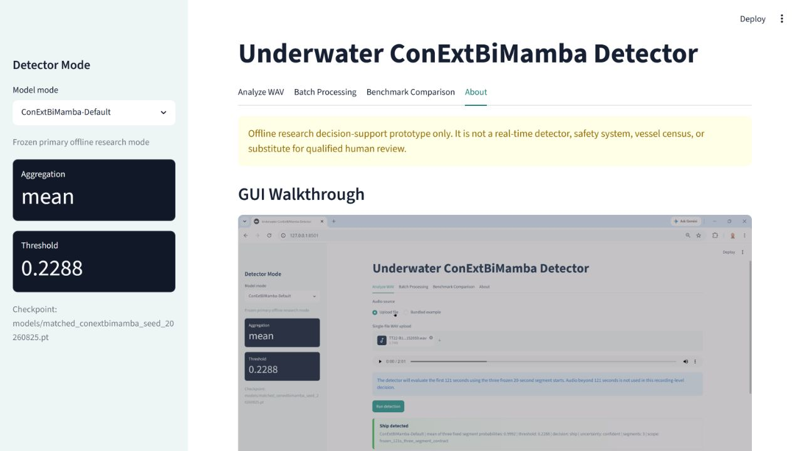

# Underwater ConExtBiMamba Detector for IARA

This project trains a **Conformer-style underwater acoustic detector with multi-head self-attention replaced by external bidirectional Mamba (ExtBiMamba)** for passive **ship/background detection** on IARA.

Default binary target:

```text
1 = ship / vessel-radiated noise
0 = background / ambient underwater noise
```

The model is designed around **IARA v2** from Zenodo: archives `A.zip` through `H.zip` plus `iara.xlsx`. The code prepares recording-level splits first, then creates fixed-length training/evaluation windows inside each split, avoiding leakage across recordings.

The full IARA audio archive is not included in this GitHub repository because it
is large and already publicly hosted. Download the dataset from the official
Zenodo DOI: https://doi.org/10.5281/zenodo.15758636. A few small example WAV
files are included under `examples/wavs/` for GUI smoke testing.

## GUI Preview



The manuscript-ready GUI screenshot is also available as a TIFF file at
`docs/Supplementary_Figure_S9_GUI_Dashboard.tiff`.

### Windows GUI and walkthrough

The verified Windows package is available at
[`deployment/windows_gui_v1/dist/ConExtBiMamba_GUI_v1.0.0_Windows.zip`](deployment/windows_gui_v1/dist/ConExtBiMamba_GUI_v1.0.0_Windows.zip).
Extract the ZIP and follow its `README_DEPLOYMENT.md`; the included VBS launchers
install, start, verify, and stop the localhost-only dashboard without opening a
console window.

Watch the interface walkthrough:
[`media/Mamba_ship_detection.mp4`](media/Mamba_ship_detection.mp4).

The packaged default mode uses arithmetic-mean aggregation with threshold
`0.2287546408673127`. The secondary conservative mode uses mean-log-survival
aggregation with threshold `0.6510023052576646`. Both modes use the same frozen
seed-20260825 checkpoint and the same three fixed 20-second evidence windows.
See [README_GUI.md](README_GUI.md) for installation, integrity, and input-contract
details.

## Architecture

```text
waveform segment
  -> log-mel spectrogram + segment CMVN
  -> input projection
  -> N x ConExtBiMamba blocks
       1/2 macaron feed-forward
       ExtBiMamba replacing MHSA
       Conformer depthwise convolution
       1/2 macaron feed-forward
  -> attentive statistics pooling
  -> ship/background head
  -> optional background/small/medium/large size head
```

`mamba-ssm` is used automatically when installed. Without it, the code uses a pure-PyTorch selective diagonal SSM fallback so the pipeline can still be tested. For full IARA training, install `mamba-ssm` on a compatible CUDA machine.

## Files

```text
configs/iara_binary.yaml              Main training config
iara_conextbimamba/model.py           Underwater ConExtBiMamba architecture
iara_conextbimamba/data.py            IARA manifest builder and segment dataset
iara_conextbimamba/features.py        Log-mel frontend and augmentations
iara_conextbimamba/metrics.py         Detection metrics
scripts/download_iara.py              Download selected IARA v2 files from Zenodo
scripts/prepare_iara.py               Build recording-level manifest
scripts/make_splits.py                Random or UO-to-glider recording-level splits
scripts/train.py                      Train model
scripts/evaluate.py                   Segment- and recording-level evaluation
scripts/infer_file.py                 Sliding-window inference on one audio file
scripts/domain_report.py              Metrics by DC/platform/CPA/range/size/type
scripts/smoke_test.py                 Shape/forward/backward test without IARA
```

## Installation

```bash
cd iara_conextbimamba_detector
python -m venv .venv
source .venv/bin/activate
pip install --upgrade pip
pip install -r requirements.txt
```

Optional, recommended for the actual model:

```bash
pip install mamba-ssm
```

## 1. Download IARA

Download only the metadata first:

```bash
python scripts/download_iara.py --out-dir data/iara_raw --files iara.xlsx
```

Download all data and extract:

```bash
python scripts/download_iara.py --out-dir data/iara_raw --files all --extract
```

Manual download is also fine. The preparation script accepts any recursive directory containing extracted audio files and `iara.xlsx`.

Expected layout can be:

```text
data/iara_raw/
  iara.xlsx
  A/...
  B/...
  C/...
  D/...
  E/...
  F/...
  G/...
  H/...
```

## 2. Prepare the manifest

```bash
python scripts/prepare_iara.py \
  --audio-root data/iara_raw \
  --excel data/iara_raw/iara.xlsx \
  --out data/iara_manifest.csv
```

The script recursively finds audio files, joins metadata when possible, and infers labels from IARA data-collection folders:

```text
A/B/C/D/F/G -> ship
E/H         -> background
```

It also adds useful evaluation columns:

```text
dc, platform, cpa, range_bin, size_label, size_name, vessel_type, duration_sec
```

If metadata column auto-detection fails, pass explicit columns:

```bash
python scripts/prepare_iara.py \
  --audio-root data/iara_raw \
  --excel data/iara_raw/iara.xlsx \
  --filename-col file_name \
  --label-col label \
  --size-col size \
  --out data/iara_manifest.csv
```

## 3. Create leakage-safe splits

Random recording-level split:

```bash
python scripts/make_splits.py \
  --manifest data/iara_manifest.csv \
  --out data/iara_manifest_splits.csv \
  --stratify dc \
  --train 0.70 --val 0.15 --test 0.15
```

UO-to-glider domain split:

```bash
python scripts/make_splits.py \
  --manifest data/iara_manifest.csv \
  --out data/iara_manifest_splits_uo_to_glider.csv \
  --split-mode uo_to_glider \
  --stratify dc
```

## 4. Smoke test

```bash
python scripts/smoke_test.py
```

Expected output includes `Smoke test OK`.

## 5. Train

Edit `configs/iara_binary.yaml` so that:

```yaml
data:
  manifest_csv: data/iara_manifest_splits.csv
```

Then run:

```bash
python scripts/train.py --config configs/iara_binary.yaml
```

Outputs:

```text
runs/iara_conextbimamba_binary/
  best.pt
  last.pt
  history.csv
  config_resolved.json
```

Default settings:

```text
sample_rate       16 kHz
segment length    10 seconds
hop seconds       5 seconds
feature           128-bin log-mel spectrogram
n_fft             1024
hop_length        512
d_model           192
layers            6
SSM state dim     16
Mamba conv width  4
Mamba expansion   2
pooling           attentive statistics pooling
loss              weighted BCE
```

## 6. Evaluate

```bash
python scripts/evaluate.py \
  --checkpoint runs/iara_conextbimamba_binary/best.pt \
  --split test
```

Outputs:

```text
runs/iara_conextbimamba_binary/eval_test/
  segment_predictions.csv
  recording_predictions.csv
  metrics.json
```

Metrics include balanced accuracy, F1, AUROC, AUPRC, false alarm rate, and miss rate at both segment and recording level.

## 7. Robustness report by IARA metadata

```bash
python scripts/domain_report.py \
  --predictions runs/iara_conextbimamba_binary/eval_test/recording_predictions.csv \
  --manifest data/iara_manifest_splits.csv \
  --out runs/iara_conextbimamba_binary/eval_test/domain_report.csv
```

This reports grouped metrics by available metadata such as `dc`, `platform`, `cpa`, `range_bin`, `size_name`, and `vessel_type`.

## 8. Inference on one recording

```bash
python scripts/infer_file.py \
  --checkpoint runs/iara_conextbimamba_binary/best.pt \
  --audio path/to/recording.wav \
  --out predictions.csv
```

## Recommended ablations

```text
1. 5 s / 10 s / 20 s / 30 s segments
2. 64 / 128 / 192 mel bins
3. 4 / 6 / 8 ConExtBiMamba blocks
4. random recording split vs UO-to-glider split
5. Conformer-MHSA baseline vs ConExtBiMamba
6. binary ship/background vs auxiliary vessel-size head
```

To enable the optional size-class head:

```yaml
model:
  num_size_classes: 4
training:
  size_loss_weight: 0.1
```

The size labels are:

```text
0 background
1 small
2 medium
3 large
```

## Notes

- The code is research-oriented and intentionally transparent.
- Use recording-level splits only; never split spectrogram windows randomly across train/test.
- For publication-grade results, run multiple seeds or 5x2 cross-validation and report recording-level metrics.
- IARA is licensed CC BY-NC 4.0, so treat the dataset as non-commercial research data unless you obtain separate permission.
